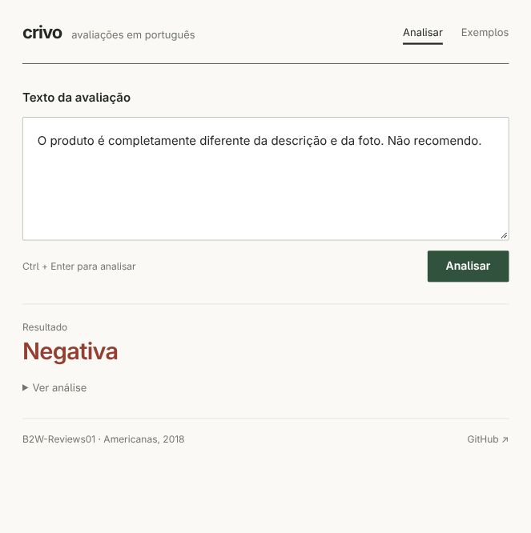

# Crivo

Classifica avaliações em português como **positiva** ou **negativa**, com
opção de **revisão**. Roda em CPU, sem serviço externo.



## Rodar

Python 3.12+ e uv.

```bash
git clone https://github.com/oyogi/crivo.git
cd crivo
uv sync --locked
uv run crivo demo
```

A demo usa o modelo publicado. Se o repositório for privado, usa a autenticação do `gh`.

<details>
<summary>Reproduzir o treino</summary>

```bash
uv run crivo download
uv run crivo train
```

</details>

Abra `http://127.0.0.1:8000`. Exemplos em `/exemplos`.
Testes: `uv run pytest -q`.
[Modelo treinado](https://github.com/oyogi/crivo/releases/tag/v0.3.0).

## Resultados

Mesmo teste com 16.988 avaliações, de produtos separados do treino.
O baseline de classe majoritária tem macro-F1 de 0,4144.

| Medida | 0.2 | 0.3 |
|---|---:|---:|
| Macro-F1 | 0,9409 | **0,9432** |
| Acurácia | 95,12% | **95,31%** |
| Erros classificando tudo | 829 | **797** |
| Textos aceitos sem revisão | 89,93% | 89,85% |
| Erro entre os aceitos | 1,90% | **1,71%** |

Na avaliação externa com **30.211 comentários da Olist**, a acurácia passou
de 91,72% para 91,89%. O modelo aceita 84,50% dos textos, com erro de 3,88%
entre os aceitos. Esses comentários não entraram no treino ou na escolha do limiar.

A conferência do benchmark mediu **11,62 ms na inferência anterior e 0,35 ms
na atual**, na mesma máquina, sem HTTP. [Ambiente e reprodução](docs/desempenho.md).

[Comparação dos modelos](reports/comparison.json) · [Avaliação externa](reports/external_olist.json)
· [Benchmark](reports/benchmark_recheck.json) · [Análise de erros](docs/erros.md)

## Decisões

- **TF-IDF + regressão logística:** treino rápido e pesos inspecionáveis.
- **Trigramas:** venceram seis configurações na validação. Só aumentar o
  vocabulário ou adicionar caracteres não ajudou.
- **Divisão por produto:** treino e teste usam produtos diferentes.
- **Limiar de revisão:** reduz erros automáticos, mantendo a cobertura visível.

As notas definem as classes: 1 e 2 são negativas; 4 e 5, positivas.
Três estrelas fica fora do treino. A avaliação é exploratória.

[Protocolo](docs/decisoes.md) · [Métricas](reports/metrics.json)
· [UML](docs/architecture.svg) · [diagrams.uml](docs/diagrams.uml)

Dados: [B2W-Reviews01](https://github.com/americanas-tech/b2w-reviews01), de
Real, Oshiro e Mafra / B2W Digital, e [Olist](https://www.kaggle.com/datasets/olistbr/brazilian-ecommerce).
Ambos CC BY-NC-SA 4.0. Código MIT.
