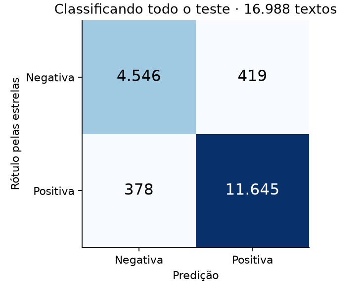
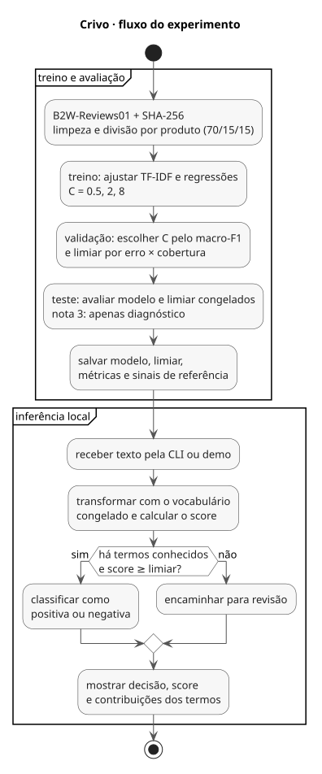
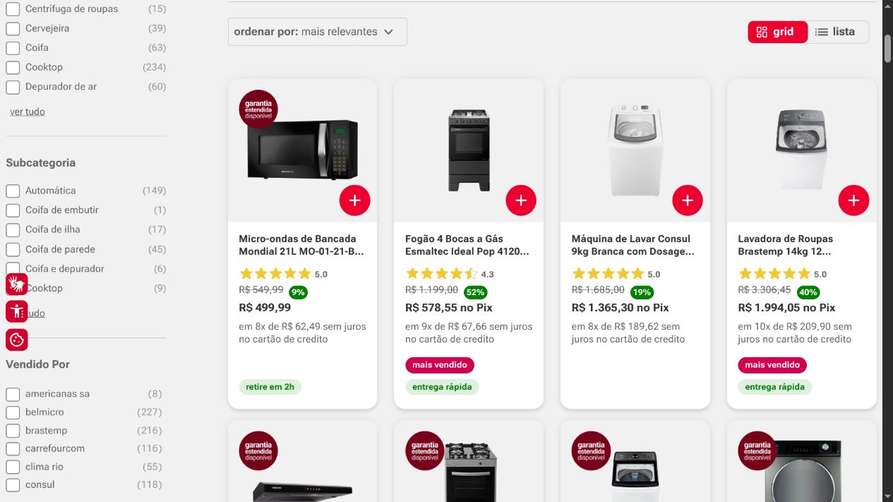
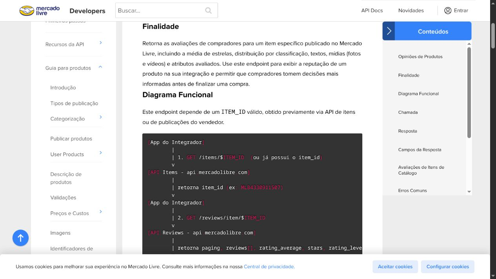

# Crivo

**Classifica avaliações em português e separa o que merece revisão.**

Uma avaliação pode elogiar o produto e reclamar da entrega. O Crivo usa um modelo
pequeno para classificar o texto — e mede o custo de deixar parte das decisões
com uma pessoa. Tudo roda em CPU, sem API paga.


## Resultado medido

132.373 avaliações na fonte; 77.044 no treino e **16.988 no teste**, com produtos
separados. TF-IDF + regressão logística. Notas 1–2 = negativa; 4–5 = positiva.

| No teste | Resultado |
|---|---:|
| Macro-F1 do baseline majoritário | 0,4144 |
| Macro-F1 do modelo | **0,9409** |
| Erro classificando tudo | 4,88% |
| Textos aceitos automaticamente | **89,93%** |
| Erro entre os aceitos | **1,90%** |


O limiar 0,81 foi escolhido na validação. Os 1,90% não incluem os textos enviados
para revisão. Score alto também erra: [os erros estão aqui](reports/errors.json).
O desenvolvimento incluiu um piloto; estes resultados são exploratórios.

## Rodar

```bash
uv sync --locked
uv run crivo download
uv run crivo train
uv run crivo serve
```

Demo em `http://127.0.0.1:8000`. Testes: `uv run pytest -q`.
Modelo treinado e metadados disponíveis na [release](https://github.com/oyogi/crivo/releases/tag/v0.2.0).
O [uv.lock](uv.lock) fixa as dependências; o download confere o SHA-256 do corpus.

## O que há por dentro

Texto duplicado sai antes da divisão por produto. O vocabulário aprende só no
treino. A validação escolhe regularização e limiar de revisão; o teste mede
cobertura e erro. Sem termos conhecidos, a saída é revisão. Os pesos exibidos
são contribuições reais do modelo linear.

[Diagrama UML](docs/architecture.svg) · [Fonte diagrams.uml](docs/diagrams.uml)
· [Protocolo e escolhas](docs/decisoes.md) · [Métricas completas](reports/metrics.json)

## Dados brasileiros, com origem

Os textos são do **B2W-Reviews01 / Americanas, de 2018**. A demo inclui três
avaliações originais, com nota, produto e linha no CSV. Não são frases geradas.
As [capturas e fontes](docs/fontes.md) mostram também a Americanas atual e a
API de avaliações do Mercado Livre como contexto do problema, sem atribuir a
elas resultados que não foram medidos.

<details>
<summary>Ver imagens, matriz de confusão e arquitetura</summary>




| Americanas — página real | Mercado Livre — documentação real |
|---|---|
|  |  |


</details>

**Limite importante:** notas são rótulos imperfeitos; três estrelas fica fora do
treino binário. O modelo não foi validado para delivery nem para textos atuais.
A limpeza global exclui conflitos de rótulo. [Ficha do modelo](docs/modelo.md).

Código MIT. Corpus e derivados CC BY-NC-SA 4.0, de Real, Oshiro e Mafra / B2W Digital.
[Atribuição e tratamento dos dados](docs/dados.md).
