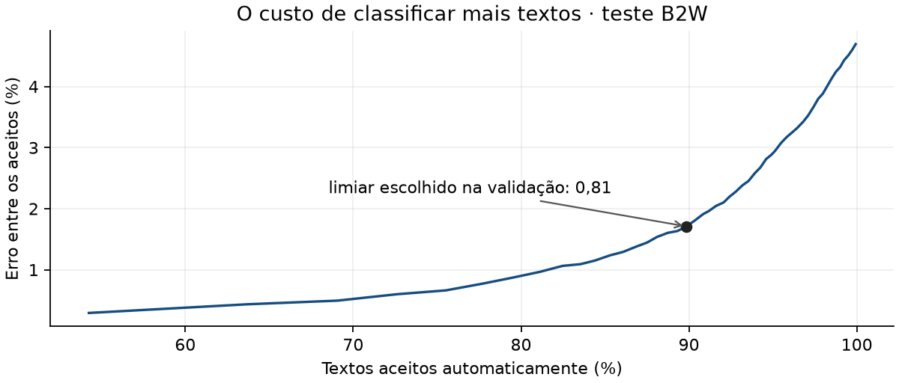

# Crivo

Classifica avaliações em português como **positiva** ou **negativa**, com
opção de **revisão**.


## Rodar

```bash
uv sync --locked
uv run crivo download
uv run crivo train
uv run crivo serve
```

Abra `http://127.0.0.1:8000`. Os exemplos ficam em `/exemplos`.

Testes: `uv run pytest -q`.
[Modelo treinado](https://github.com/oyogi/crivo/releases/tag/v0.2.0).

## Resultados

Teste com 16.988 avaliações de produtos que não aparecem no treino.

| Medida | Resultado |
|---|---:|
| Macro-F1 do baseline | 0,4144 |
| Macro-F1 do modelo | **0,9409** |
| Erro classificando tudo | 4,88% |
| Parcela classificada sem revisão | **89,93%** |
| Erro nessa parcela | **1,90%** |



## Decisões

- **TF-IDF + regressão logística:** treino em CPU e pesos fáceis de inspecionar.
- **Divisão por produto:** evita avaliar o modelo nos mesmos produtos do treino.
- **Revisão por limiar:** reduz o erro nas decisões automáticas; o limiar é
  escolhido na validação.

As notas definem as classes: 1 e 2 são negativas; 4 e 5 são positivas.
Três estrelas fica fora do treino. O corpus é de 2018; o resultado se refere
à base filtrada, após um desenvolvimento exploratório.

[Protocolo](docs/decisoes.md) · [Métricas](reports/metrics.json)
· [Erros](reports/errors.json) · [UML](docs/architecture.svg)
· [diagrams.uml](docs/diagrams.uml)

Dados: [B2W-Reviews01](https://github.com/americanas-tech/b2w-reviews01),
Real, Oshiro e Mafra / B2W Digital. CC BY-NC-SA 4.0. Código MIT.
